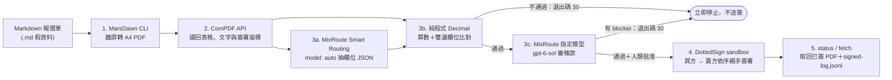

# quote-sign

Markdown 報價單 → PDF → AI 檢查 → 電子送簽 → 追蹤歸檔。

OPEN LAB AI 實作挑戰賽（2026）參賽作品，整合 **MarsDawn CLI**、**ComPDF**、**MixRoute（Smart Routing＋指定模型）** 與 **DottedSign sandbox**，把報價單轉檔、金額核對、條款審查、建立簽署任務到取回已簽 PDF 串成一條可稽核的命令列流程（附 Claude Code skill）。

- 規格文件：[`docs/spec.md`](docs/spec.md)
- 送簽設計：[`docs/design-signing.md`](docs/design-signing.md)
- 外部服務筆記：[`docs/service-notes.md`](docs/service-notes.md)

## 架構流程



- **全流程驗證**：2026-11-15 於 `main` 實跑正常版（退出碼 0）與抓錯版（退出碼 30），抽欄位由 MixRoute Smart Routing 動態選用 `deepseek-v4-flash`，條款審查使用 `gpt-6-sol`。
- **端到端簽署驗證**：2026-11-13 完成 DottedSign sandbox 任務 407 端到端測試，由買方與賣方依序透過分享連結親手簽署完成（`completed_at=2026-11-13T20:03:30+08:00`），`status`／`fetch` 皆退出 0，成功取回已簽 PDF 與含 SHA-256 雜湊的 `signed-log.jsonl`。
- **測試環境說明**：DottedSign 使用免費 sandbox 環境，下載的已簽 PDF 帶有測試浮水印（實測顯示 `Sample` / `DottedSign`）；目前送簽請求未開啟自動寄信（`informable=false`），詳見「限制」。

## Claude Code skill

入口：[`skills/quote-sign/SKILL.md`](skills/quote-sign/SKILL.md)。可請 Claude Code 讀取此 repo 內 skill，依批准關卡逐步操作；不會安裝到全域，也不改動其他環境設定。文件中的命令為操作範例，送簽前仍須取得人類明確授權。

## 做什麼

`quote-sign <檔.md>` 依序做：

0. **檢查輸入檔**：只收一般的 `.md` 檔，不跟符號連結；不符就以退出碼 3 停下，什麼服務都不碰。規則見下方「安全」。
1. **轉 PDF**：`marsdawn export <私有暫存複本> -o out/<檔名>.pdf --force --json`，讀 JSON 結果判斷成功（純命令列、離屏，不開視窗）。交給 marsdawn 的是上一步讀進記憶體的內容，寫在只放這一個檔的私有暫存目錄裡，轉完即刪。PDF 放在 `out/`（已被 .gitignore），不放回 `sample/`，因為 `.gitignore` 有放行 `sample/*.pdf`。
2. **ComPDF 讀 PDF**：呼叫 ComPDF Document Parsing API，取回表格（HTML 表格轉成列）和每段文字。
3. **三層檢查**，任一層不過就停、指出哪一行、不送簽：
   - **抽欄位**（MixRoute Smart Routing，`model: auto`，用 Smart Routing key）：把 PDF 文字整理成固定 JSON，由平台自己選模型。提示要求「照文件原樣抄、不重算、不修正」。
   - **算數（純程式，Decimal，不用模型）**：每列 數量×單價＝小計；小計加總＝未稅合計；營業稅＝未稅合計×稅率（四捨五入到元）；含稅總計＝未稅合計＋稅額；有效期限未過、有效期限不早於報價日期、交付日期不早於報價日期、必要欄位都在。
   - **兩邊讀法比對**：ComPDF 表格與文字的規則式讀法 vs 模型抽到的欄位，逐欄比對；不一致就逐項列出「ComPDF 讀到 X，模型讀到 Y」，不會默默採用任何一邊。算數檢查兩邊各跑一次。
   - **審條款**（指定較強的模型，預設 `gpt-6-sol`，用一般 MixRoute key，**不走 auto**）：付款條件、交付日期、條款之間有沒有矛盾或缺漏。只有「條款互相矛盾，或付款條件／交付日期缺漏、含糊、不可能」才會擋（blocker），其餘寫成備註。前面算數或比對已經不過時，這一步不執行（省錢）。
4. **送簽**：`--send` 在檢查通過後建立 sandbox 任務，簽署順序買方、賣方（目前不寄邀請信）；簽名由收件人完成，本工具永不代簽。
5. **追蹤與取回**：獨立 `status` / `fetch` 指令查狀態、下載已簽 PDF 並寫入「誰、何時、哪一版」紀錄。

每次呼叫模型都會印出 MixRoute **回應裡回報的模型名稱**（抽欄位走 `auto` 時，印的就是平台選到的模型；回應沒帶就印 `auto`）、token 數與花費（「估算」或「實際」），並累計寫入 `~/.quote-sign/spend.json`。抽欄位與審條款共用同一份花費檔。

## 安裝

需要 macOS 15+、Python 3.9+、[marsdawn](https://marsdawn.southern-light.dev/cli/agents/)（`brew install redtear1115/tap/marsdawn`）。執行時沒有第三方 Python 套件（只用標準函式庫）。

```sh
python3 -m venv .venv
.venv/bin/pip install --upgrade pip        # 舊 pip（<21.3）不能 -e 安裝
.venv/bin/pip install -e . -r requirements-dev.txt
```

## 設定（環境變數，只寫名稱）

金鑰與簽署信箱只從環境變數讀取，請在執行前由安全的外部環境注入；程式不讀取或建立任何環境設定檔。文件只列變數名稱。

| 變數 | 第 1～3 步需要 | 用途 |
|---|---|---|
| `MIX_ROUTE_SMART_ROUTING_KEY` | 是 | MixRoute **Smart Routing key**（與一般 key 是兩把不同的 key），只給抽欄位，請求 `model: auto` |
| `MIX_ROUTE_API_KEY` | 是 | MixRoute 一般 key，只給審條款（指定模型） |
| `MIX_ROUTE_BASE_URL` | 是 | 兩把 key 共用的 MixRoute（OpenAI 相容）base URL，要是 https |
| `COMPDF_PUBLIC_KEY` | 是 | 放在 `x-api-key` header |
| `COMPDF_SECRET_KEY` | 是（設定預檢） | 目前讀取 API 不傳送 |
| `DOTTEDSIGN_SANDBOX_CLIENT_ID`、`DOTTEDSIGN_SANDBOX_CLIENT_SECRET` | 否 | 真正送簽與 status / fetch 需要；dry-run 不需要 |
| `QUOTE_SIGN_BUYER_EMAIL` | 否 | --send（包含 dry-run）需要，買方先簽 |
| `QUOTE_SIGN_SELLER_EMAIL` | 否 | --send（包含 dry-run）需要，賣方後簽 |

缺變數時只列出**變數名稱**（退出碼 2）。只有 `src/quote_sign/secrets.py` 會碰環境變數，所有輸出和 log 都先過遮罩（金鑰換成 `***`）。信箱的本地部分與第一個網域標籤分別遮罩：少於 4 個字元完全隱藏為 `***`，4 個以上只保留首字元加 `***`；保留最後一個網域標籤，例如 `buyer@example.invalid` → `b***@e***.invalid`。

**隱私**：這支程式會把 PDF 送到 ComPDF，把 PDF 文字送到 MixRoute 和它背後的模型供應商。只能用範例（假資料）報價單，不要送真實客戶資料或私人內容。

## 安全

MixRoute、ComPDF 與 DottedSign 的錯誤訊息只顯示 HTTP 狀態與固定原因，絕不顯示回應內容。

### 輸入檔規則

在檢查金鑰與信箱設定、建立任何服務連線、轉 PDF 之前，先檢查輸入檔。不符就印「輸入檔不符規則（原因）：<你輸入的路徑>」，退出碼 3。訊息只印你輸入的路徑，不印檔案內容，也不印連結指向哪裡。

- 檔名要以 `.md` 或 `.MD` 結尾，只收這兩種寫法，`.md` 前面要有字。`.Md`、`.markdown`、`.md.txt`、`.txt`、沒有副檔名都拒絕。
- 要是一般檔案。目錄、FIFO、裝置檔、socket 都拒絕。
- 不跟符號連結。檔案本身是連結（連到同目錄的 `.md` 也算、斷掉的連結也算），或路徑中任何一層目錄是連結，都拒絕。
  - 相對路徑從目前目錄往下逐層檢查，絕對路徑從 `/` 開始。
  - macOS 中由 root 擁有、連到 `/private/` 直接子目錄的系統別名 `/tmp`、`/var`、`/etc`，只在路徑第一個元件時接受。其他位置或其他符號連結、`..`、符號連結檔案與硬連結仍拒絕。
- 路徑不能有 `..`。
- 硬連結（同一個檔有兩個以上的名字）也拒絕。
  - 理由：從路徑看不出另一個名字在哪裡，可能是 repo 外的檔。拒絕的代價很小：git clone 不會產生硬連結；真的碰到時，複製成新檔再跑即可。
  - 不拒絕的代價：本機有寫入權的人能讓一個看起來普通的 `.md` 內容其實是別的檔。
- 找不到檔案，或路徑中有一層不是目錄：維持退出碼 2。

檢查和讀取用同一個檔案描述子：逐層用 `O_NOFOLLOW` 開，對開好的那一個 `fstat` 判斷類型，再從它讀進記憶體。之後不再用路徑開原檔：

- 轉 PDF：把這份內容寫進私有暫存目錄（目錄 0700、檔案 0600，轉完即刪），交給 marsdawn。
- 送簽：任務紀錄裡的來源雜湊也是這份內容的雜湊。

所以檢查之後原檔被換掉，送出去的仍是檢查過的內容。

`--out-dir` 遵循相同的目錄規則：不能有 `..`，任何已存在的路徑元件都不能是符號連結（上述第一層系統別名除外），也必須是目錄；尚未存在的目錄允許稍後建立。在任何服務呼叫前先檢查，不符就以退出碼 3 印出「輸出目錄不符規則（原因）：<你輸入的路徑>」。PDF 與 `signed/` 內檔案都透過目錄描述子寫入，檔案權限為 0600；PDF 先寫暫存檔再原子替換。轉檔與寫入錯誤訊息不含路徑或服務回傳的原始訊息。

### Markdown 裡的圖片

實測 marsdawn 0.7.7（2026-11-13，自製的假 PNG，不連外網）：

- 直接轉原檔時，**和 Markdown 同目錄或子目錄的圖片會嵌進 PDF**（``、``）。PDF 之後會上傳 ComPDF。
- 不會嵌的：`../` 跳出目錄、絕對路徑、指到目錄外的符號連結、`file://`、HTML ``、遠端網址。遠端圖片要加 `--allow-remote-images` 才會載入，本工具不加；用本機回環伺服器測，收到 0 次請求。

本工具轉的是私有暫存目錄裡的複本，那個目錄只有這一個 Markdown 檔。所以**報價單引用的本機圖片都不會嵌入、不會上傳**。同一份測試文件改用本工具的轉檔函式，PDF 裡沒有任何一張測試圖片。代價：需要 logo 等本機圖片的報價單目前不支援。

## 用法

```sh
quote-sign sample/quote-Q2026-031.md                    # 第 1～3 步
quote-sign sample/quote-Q2026-031-bad.md                # 抓錯情境
quote-sign sample/quote-Q2026-031.md --today 2026-11-20 # 只重現歷史假資料檢查
quote-sign sample/quote-Q2026-031.md --send # 人類批准後，通過才建立 sandbox 任務
```

選項：`--out-dir`（預設 `out`）、`--extract-model`（預設 `auto`，MixRoute Smart Routing）、`--review-model`（預設 `gpt-6-sol`；必須與抽欄位不同模型，`auto` 與 `gpt-6-sol` 算不同）、`--spend-cap-usd`（0～5，預設 5）、`--today`、`--send`、`--dry-run`、`--resend`。後兩者必須搭配 `--send`。狀態固定存放於 `~/.quote-sign/`（家目錄由目前 uid 向系統帳號資料庫（pwd）查詢，不使用 `HOME` 環境變數），不提供自訂位置。
除了 `auto`，模型必須在 `src/quote_sign/llm.py` 的 `PRICES` 有單價（用來估算花費），沒有就拒絕呼叫。`--extract-model` 指定的值會連同 Smart Routing key 一起送出，`--review-model` 的值連同一般 key 一起送出；審條款不要設成 `auto`。報價單的有效期限若已過，檢查會不過；錄影日期晚於 2026-12-05 時若只需重現歷史假資料檢查，可加 `--today 2026-11-20`；不得用它繞過真實送簽的到期檢查。

## 第 4～5 步：sandbox 送簽、追蹤與下載

以下是命令範本，`TASK_ID` 換成實際建立的 sandbox 任務正整數 ID；送簽前請先取得人類明確批准，並依 skill 關卡操作。

```sh
quote-sign sample/quote-Q2026-031.md --send --dry-run
quote-sign sample/quote-Q2026-031.md --send
quote-sign status TASK_ID
quote-sign status TASK_ID --watch 10
quote-sign fetch TASK_ID
quote-sign fetch TASK_ID --out-dir out
```

Dry-run 會跑第 1～3 步（仍會呼叫 ComPDF 與 MixRoute），通過後印完整 DottedSign 請求形狀，信箱遮罩、PDF base64 省略；不建立 DottedSign client、不寫任務紀錄、不寄信。送出前必須取得人類對本次假資料版本、兩個已核准測試收件人及額度的明確批准；dry-run 不等於批准。真正送簽需要兩個 DottedSign 變數。API 網域固定 sandbox，不能改到 production。

買方先簽、賣方後簽；**本工具永不代簽**。Sandbox PDF 帶有測試浮水印（官方文件標註為 **Non official**，實測下載檔案顯示 **Sample / DottedSign**）。簽名欄由 ComPDF 讀到的兩行簽署位置換算，位置缺失即停。文件中的簽署人顯示名稱若含信箱或 `@`，或不是字串，會拒絕送簽（含 dry-run），退出碼 40。同一報價單號與 Markdown 版本已有 `created` 任務時會沿用；只有加 `--resend` 才另建。若上一次結果為 `unknown`（沒有 task_id），會停止並退出 40，請先到 DottedSign web UI 或用 `quote-sign status` 檢查，確認結果後由人類決定下一步，不得自行使用 `--resend`。

Sandbox 每 24 小時限 20 個任務，本機保護門檻 15（含失敗與結果不明的嘗試）。403 立即停止。建立任務遇 429、5xx、網路逾時不自動重試；可能已建立時先回報人類，由人類核對既有任務；不得自動重送。GET 最多三次，等待 1、2 秒；401 更新 token 後重試一次。

`--watch N` 接受 1～20，每 30 秒查詢，遇最終狀態提早停止。`fetch` 只下載 completed 任務，寫入 `<out-dir>/signed/<quote_no>-signed.pdf`，並追加及印出一行 `signed-log.jsonl`：角色、顯示名稱、完成時間（UTC+8）、來源 Markdown／送簽 PDF／已簽 PDF 雜湊；不存信箱或下載連結。沒有本機任務紀錄時，檔名使用 `task-<id>-signed.pdf`，未知名稱與來源版本記為 null。

固定狀態目錄 `<系統帳號的家目錄>/.quote-sign/` 包含 `spend.json`、`sign-tasks.jsonl` 與各自的 lock，檔案權限 0600、目錄 0700。任務紀錄在呼叫前就寫 sending，之後追加 created／failed／unknown；token 永遠只在記憶體。預簽下載不帶 Authorization，也不跟隨重新導向。

錯誤範例的第二列小計寫成 12,000，程式在第 3 步指出「第 2 列小計應為 15,000」並退出 30；即使帶 `--send` 或 `--send --dry-run` 都不會呼叫 signer 或 DottedSign。

## 退出碼

| 碼 | 意思 |
|---|---|
| 0 | 檢查／送簽／dry-run 成功，或 status 為 draft、waiting、completed，或 fetch 成功 |
| 1 | 其他工具錯誤 |
| 2 | 用法或設定錯誤（缺檔、缺環境變數、兩個模型相同、參數無效） |
| 3 | 輸入檔或 `--out-dir` 不符規則（副檔名、符號連結、`..`、檔案／目錄類型、硬連結；見「安全」）。不檢查金鑰設定、不轉 PDF、不呼叫任何服務 |
| 10 | 停在第 1 步（轉 PDF 失敗） |
| 20 | 停在第 2 步（ComPDF 讀取失敗） |
| 30 | 停在第 3 步（算數、兩邊讀法不一致、日期或條款審查不過） |
| 31 | 累計花費已達上限（啟動預檢即停止），或第 3 步的模型呼叫／執行途中花費紀錄失敗 |
| 32 | 本機狀態無法使用（查不到系統帳號家目錄，或花費紀錄損毀、不可讀、不是一般檔案、是符號連結、總額與明細不符）；在轉 PDF 與呼叫任何服務之前就停，不改寫紀錄 |
| 40 | 送簽停止／失敗，或追蹤、下載錯誤 |
| 41 | DottedSign 本機或 API 配額用完 |
| 42 | status 為 declined、expired、voided、deleted、unknown |
| 43 | fetch 時尚未完成簽署 |
| 70 | 未預期的錯誤（只印例外類型名稱，不印例外訊息或 traceback） |
| 130 | 使用者中斷，無 traceback |

## 花費與上限

- 審條款：`gpt-6-sol`（OpenAI，US$2.00／10.00 每百萬 token，輸入／輸出），單價取自 MixRoute 公開的 Model Marketplace（2026-11-13）。
- 抽欄位：`auto`，平台選模型，事前不知道單價，所以 `auto` 不在 `PRICES`。呼叫前的最壞情況檢查用 `PRICES` 裡**最貴**的輸入單價與**最貴**的輸出單價（目前都是 `gpt-6-sol` 的 2.00／10.00）。回應回報的 `model` 若是 `PRICES` 裡的模型，花費改用那個模型的單價估算；不在（或沒回報）就維持最貴單價，寧可高估。
- MixRoute 回應**沒有花費欄位**，只有 token 數，所以花費＝token×公告單價，一律標「估算」。如果之後回應帶了數字的 `usage.cost` 或 `cost`，程式會改用它並標「實際」。
- 每次呼叫前先看本機花費檔 `~/.quote-sign/spend.json`：累計已達上限，或「累計＋這次的最壞情況」會超過上限，就拒絕呼叫（退出碼 31）。兩把 key 的呼叫算在同一份花費檔裡。啟動時先在鎖內檢查花費檔；損毀、不可讀、不是一般檔案、是符號連結或總額與明細不符都會在轉 PDF 與呼叫任何服務前停止（退出碼 32），不改寫紀錄。上限限定 US$0～5，不能超過 US$5。每次呼叫前用 flock 跨程序鎖預留最壞費用，取得成功回覆後才結算；逾時、失敗或中斷會保留預留額度。
- 只有刪除 `spend.json` 才會重設累計；手動修改總額會因為必須等於每筆明細的加總而被拒絕。更換 `HOME` 不會改變狀態位置或重設累計。
- 實測累計見下方「實測結論」。

## 實測結論（2026-11-13～2026-11-15，只送範例假資料）

逐點對應 `docs/spec.md` 的「還不確定的事」。

1. **ComPDF 讀表格準不準**：用的是 REST API（Document Parsing，`x-api-key` 帶 Public Key），沒有實測 MCP。MCP 是官方開源、要自己在本機跑的服務（Python、HTTP），底層是同一批 REST 端點，所以未驗證 MCP（要起本機服務，且沒有額外價值）。範例報價單（繁中，1 頁 A4）的 4 欄×3 列品項表、合計、買賣方、日期、條款全部讀對，千分位數字逐格一致；差別只有全形括號變半形。表格以 HTML 輸出，不必退回「讀純文字再由 AI 解析」。每頁約 3～7 秒。
   - 文件與實際不符：文件說 documentParsing 直接回 JSON；實際回任務資訊與預簽 `downloadUrl`，下載到的是 zip（內有 `result_json.json`）。程式兩種都接，zip 只在記憶體裡開，下載網址不帶 API key。
   - 免費額度：文件寫線上平台每月 40 頁免費；API 端數字沒寫。
2. **DottedSign 能不能上傳本機 PDF、指定簽名欄位置**：依官方 REST 文件，可以（`base64_file`；簽名欄位用頁碼加 `coord` 座標；`search_key` 不支援簽名欄位）。2026-11-13 已在 sandbox 完成任務 407 端到端實測，由買方、賣方依序透過分享連結親手簽完，`status`／`fetch` 皆退出 0，成功取回已簽 PDF 與簽署紀錄（未自動寄出邀請信，見「限制」）。DottedSign MCP 找不到官方文件，沒評估。
3. **兩個 MCP 的官方設定文件**：ComPDF MCP 已讀；DottedSign 只有第三方目錄。重點與出處見 [`docs/service-notes.md`](docs/service-notes.md)。
4. **MixRoute Smart Routing**：它是另一種 API key（要在 MixRoute 主控台建「Smart Routing key」），不是模型名，所以 `GET /models` 的清單裡沒有 smart／auto。本工具採兩把 key 分工：抽欄位送 `POST /v1/chat/completions`、`"model": "auto"`、Bearer 帶 `MIX_ROUTE_SMART_ROUTING_KEY`；審條款用一般 `MIX_ROUTE_API_KEY` 指定 `gpt-6-sol`，不走 auto。程式會讀回應的標準 `model` 欄位並印出。2026-11-15 於 `main` 實跑正常版與抓錯版，平台皆自動路由至 `deepseek-v4-flash`，審條款為 `gpt-6-sol`。
5. **MixRoute 模型與價格**：一般 key 的 `GET /models` 有 25 個模型；回應只有 `usage` token 數，沒有花費欄位。deepseek 是 reasoning 模型，輸出 token 包含思考 token，`max_tokens` 要給寬。
6. **marsdawn export**：0.7.7，約 0.9 秒，不開視窗、不要權限，JSON 是單行 `{"ok":true,"output":…,"pages":1,…}`。

實測累計花費（MixRoute，**估算**）：截至 2026-11-15，本機花費檔 13 筆累計約 **US$0.024075**（含開發期測試與 2026-11-15 `main` 正常版／抓錯版檢查，其中 11-15 兩次檢查共約 US$0.0045）。上限 US$5。

**審條款 prompt 的調整**：第一次實跑，審條款模型把「沒寫授權起算日」「沒寫自訂主題的規格」判成 blocker，使正常版被擋（紀錄：退出碼 30）。因為規格只要求看付款條件、交付日期和互相矛盾或缺漏，所以把 blocker 限縮成「條款互相矛盾，或付款條件／交付日期缺漏、含糊、不可能」，其餘當備註。之後正常版通過。這代表審條款是有主觀成分的模型判斷，不是保證；算數與比對才是確定性的。

## 兩個情境

以下為 2026-11-15 於 `main` 實跑的輸出，抽欄位走 MixRoute Smart Routing（`model: "auto"`，平台回報 `deepseek-v4-flash`），審條款指定 `gpt-6-sol`。

**正常**（`sample/quote-Q2026-031.md`，退出碼 0）：

```
第 1 步（轉 PDF）完成：1 頁。
第 2 步（ComPDF 讀取）完成：1 頁。
ComPDF 讀取的表格：
項目                   | 數量 | 單價 (NT$) | 小計 (NT$)
MarsDawn 團隊授權 (年) | 12   | 1,800      | 21,600
自訂主題設計           | 1    | 15,000     | 15,000
導入教學 (2 小時)      | 1    | 6,000      | 6,000
[MixRoute] 抽欄位 模型=deepseek-v4-flash 輸入=743 輸出=508 花費=US$0.000246（估算）秒數=4.7708
[MixRoute] 審條款 模型=gpt-6-sol 輸入=745 輸出=247 花費=US$0.003960（估算）秒數=3.1434
第 1～3 步全部通過。
品項：3 筆。
未稅合計：NT$42,600
營業稅：NT$2,130
含稅總計：NT$44,730
未送簽（預設只做到第 3 步；加 --send 才會嘗試送簽）
exit=0
```

**抓錯**（`sample/quote-Q2026-031-bad.md`：第 2 列小計從 15,000 改成 12,000，加 `--send` 也不會碰到 signer；退出碼 30）：

```
第 1 步（轉 PDF）完成：1 頁。
第 2 步（ComPDF 讀取）完成：1 頁。
ComPDF 讀取的表格：
項目                   | 數量 | 單價 (NT$) | 小計 (NT$)
MarsDawn 團隊授權 (年) | 12   | 1,800      | 21,600
自訂主題設計           | 1    | 15,000     | 12,000
導入教學 (2 小時)      | 1    | 6,000      | 6,000
[MixRoute] 抽欄位 模型=deepseek-v4-flash 輸入=743 輸出=670 花費=US$0.000292（估算）秒數=5.5286
第 3 步檢查未通過，停止，不送簽：
- 第 2 列小計應為 15,000（文件上是 12,000）
- 小計加總應為 39,600（文件上的未稅合計是 42,600）
（條款審查未執行，因為前面已經不過）
exit=30
```

## 測試（不打外部服務）

```sh
.venv/bin/pytest -q
```

CI：`.github/workflows/ci.yml` 在每個 PR 和推到 main 時，用 GitHub 代管的 ubuntu runner 以 Python 3.10、3.13 各跑一次 pytest（ubuntu-latest 沒有 3.9；3.9 在本機用 macOS 內建的 Python 跑）。不放任何金鑰，不連外部服務：`tests/conftest.py` 把 socket 連線全部擋掉，所有服務都換成假的 transport。CI 上沒有 marsdawn，測試也不需要。

涵蓋：輸入檔規則（副檔名、檔案或目錄是符號連結、`..`、目錄／FIFO／裝置檔、硬連結、檢查後換檔仍用檢查過的內容、拒絕時不建立任何服務）、算數（全對、第 2 列小計應為 15,000、加總／稅額／總計、全形數字、千分位、空列、小數）、停下邏輯（任一層不過 → 非 0、signer 沒被呼叫、兩邊不一致有標出）、花費上限（含 `auto` 的最壞情況與回報模型的估價）、兩把 MixRoute key 各走各的路徑（抽欄位 → Smart Routing key＋`auto`，審條款 → 一般 key＋指定模型）、金鑰保護（假值不出現在 `--help`、失敗路徑、例外路徑、log；缺變數只報名稱；原始碼裡除 `secrets.py` 外沒人碰環境變數）、外部呼叫用假的 transport（斷言 header 名稱 `x-api-key`、下載請求沒帶 key、不跟隨重新導向）。

## 限制

- **DottedSign sandbox 環境限制**：送簽固定連到 `api.sandbox.dottedsign.com`（不開放切換 production）。每 24 小時上限 20 個任務（本機保護門檻 15）、資料每季清空，下載的已簽 PDF 帶有測試浮水印（官方文件標註為 Non official，實測顯示 `Sample` / `DottedSign`）。
- **未自動寄出簽署邀請信**：送簽請求目前未開啟 `informable`（預設 `false`），建立任務後不會自動發送邀請信；端到端實測係由買賣雙方透過分享連結依序親手簽署完成。
- ComPDF 側的「規則式讀法」只認這份範例報價單的欄位格式（賣方、買方、報價日期、有效期限、未稅合計、營業稅、含稅總計、品項表的 項目／數量／單價／小計）。別的版型要調。
- 模型把數字抄成不同格式（例如稅率 0.05 與 5）會被當成不一致。
- 抽欄位走 Smart Routing，選到哪個模型由平台決定，可能與審條款是同一家甚至同一個模型；程式只擋 CLI 參數兩邊相同，不檢查回應回報的模型。
- 審條款是模型判斷，會因提示與模型版本而不同。
- 文件內容會當作資料送給模型；提示要求忽略文件中的指令，但這不是保證。算數與比對是程式，不受影響。
- 這是本機單一使用者工具：花費上限只能防止意外誤用與環境變數繞過，無法阻止擁有此帳號權限的人刻意刪除或重寫檔案。
  - 只有刪除 `<系統帳號的家目錄>/.quote-sign/spend.json` 才會重設累計；總額必須等於明細加總，手動改低總額會被拒絕。
  - 預留額是估算的最壞情況：輸入 token 用字元數估（某些 tokenizer 下可能低估），輸出用 `max_tokens` 上限。
  - 逾時、網路錯誤、HTTP 錯誤、Ctrl-C：預留額留在帳上，不會退回，累計會偏高（偏安全）。要歸零只能刪除 `spend.json`。
  - 花費是 token × 公告單價的估算，不是 MixRoute 的帳單。
- 本機圖片不會嵌進 PDF（見「安全」），需要圖片的報價單目前不支援。

## 授權

本專案以 [MIT License](LICENSE) 授權釋出。
