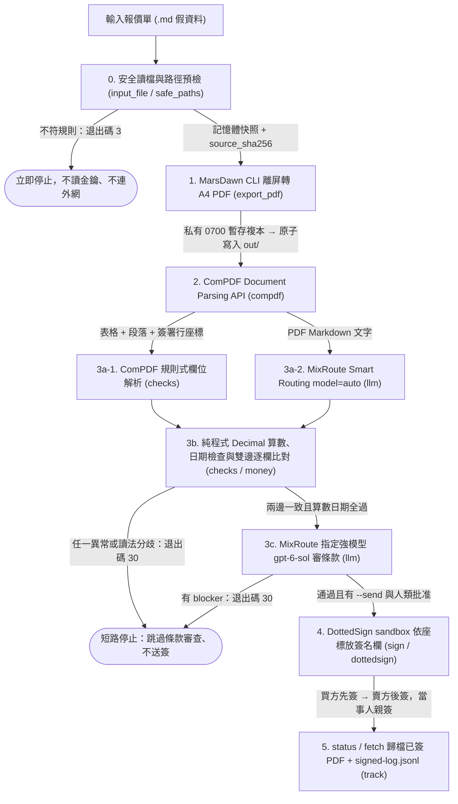

# quote-sign 架構總覽

`quote-sign` 是一套將 Markdown 報價單串成「轉檔 → 讀回 → 核對 → 送簽 → 歸檔」的命令列工具與 Claude Code skill。執行期零第三方 Python 相依（僅使用 Python 3.9+ 標準函式庫），整合 **MarsDawn CLI**、**ComPDF Document Parsing**、**MixRoute（Smart Routing＋指定強模型）** 與 **DottedSign sandbox**，以「先驗最終 PDF、算數不用 LLM、AI 永不代簽、安全與成本 Fail-Closed」為核心設計原則。

## 系統架構與資料流

- **實測基準**：2026-11-15 於 `main` 實跑正常版（退出碼 `0`）與抓錯版（退出碼 `30`，短路跳過審條款），抽欄位由 MixRoute Smart Routing 動態選用 `deepseek-v4-flash`，審條款使用 `gpt-6-sol`；2026-11-13 完成 DottedSign sandbox 任務 407 端到端親簽與 `status`／`fetch` 歸檔驗證。

## 核心設計取捨（Why）

### 1. 為何以 ComPDF 讀回最終 PDF，而非直接解析 Markdown？

- **所簽即所驗**：當事人簽署的是轉檔後的 A4 PDF，而非原始 `.md`。若排版引擎轉檔時出現表格斷裂、數字漏字或換行錯位，只檢查 Markdown 會漏抓。
- **一次取得結構化內容與簽署座標**：`compdf.py` 呼叫 `POST https://api-server.compdf.com/server/v2/process/idp/documentParsing`（`x-api-key` 帶 Public Key），解析回傳結果中的 HTML 表格（`_TableParser` 轉成二維陣列）、段落文字，以及「買方簽署」「賣方簽署」兩行的 `page_id` 與四角像素座標（`position`）。
- **直連 DottedSign 定位需求**：DottedSign 的 `search_key` 不支援 `signature` 欄位，簽名欄必須提供精確座標；由 ComPDF 讀回最終 PDF 同時解決了內容驗證與簽名定位。
- **實測容錯與隔離**：官方文件稱端點直回 JSON，實測回傳預簽 `downloadUrl` 且為 ZIP（內含 `result_json.json`）；程式兩種格式皆支援，下載預簽網址時**不帶 API key**，ZIP 僅於記憶體解壓並設 `25 MB` 結果上限。

### 2. 為何拆分 MixRoute Smart Routing（`auto`）＋純程式 `Decimal` 算數＋指定強模型？

- **金額與日期絕不交給 LLM 算**：`checks.py` 與 `money.py` 以 Python `Decimal` 執行確定性計算——逐列驗「數量 × 單價 ＝ 小計」、小計加總 ＝ 未稅合計、營業稅 ＝ 未稅合計 × 稅率（`ROUND_HALF_UP` 四捨五入至元）、含稅總計 ＝ 未稅合計 ＋ 稅額，以及有效期限與交付日期邏輯。
- **雙源交叉驗證**：算數與日期檢查對「ComPDF 規則式讀法」與「模型抽出的 JSON」**各跑一次**，再執行 `diff_quotes` 逐欄比對。只要兩邊讀法不同就明列差異，不默默採信任何一方。
- **兩把 MixRoute Key 職責分流（`PurposeRoutedClient`）**：
  - **抽欄位**使用 `MIX_ROUTE_SMART_ROUTING_KEY` 送 `"model": "auto"`，由 MixRoute Smart Routing 動態挑選高性價比模型（實測自動路由至 `deepseek-v4-flash`），系統提示要求「原樣抄錄、不得重算修正」。
  - **審條款**使用一般 `MIX_ROUTE_API_KEY` 指定較強模型（預設 `gpt-6-sol`，CLI 強制兩階段模型參數不可相同），只聚焦語意矛盾與條款缺漏，且將 `blocker` 限縮在「條款互相矛盾」或「付款條件／交付日期缺漏、含糊、不可能」，其餘列為不擋簽的 `note`。
- **短路省額度**：只要算數、日期或雙邊比對任一失敗，流程直接以退出碼 `30` 終止，**不呼叫條款審查模型**，也不接觸送簽模組。

### 3. 人機邊界：AI 永不代簽與三份 SHA-256 稽核鏈

- **預設只檢查、明確授權才送簽**：未帶 `--send` 時 CLI 注入 `RefusingSigner`；`--send --dry-run` 只印出遮罩後的請求 JSON，不建立 DottedSign client、不寫送簽紀錄。
- **程式碼層級禁止代簽**：`dottedsign.py` 僅實作 4 個端點（`POST /v1/oauth/token`、`POST /v1/sign_tasks`、`GET /v1/sign_tasks`、`GET /v1/sign_tasks/download_link`）與預簽下載，網域寫死為 `https://api.sandbox.dottedsign.com`，沒有任何 sign、approve、decline 或 void 操作。
- **座標精準定位與依序親簽**：`sign.py` 將 ComPDF 144 dpi A4 錨點（1190×1684 px）換算為 PDF 點（`x × 0.5`、`y = 842 − y_px × 0.5`，頁碼轉 0 起算），依 21 等寬字元切出強制 `signature`（第 5～13 單位）與 `datefield`（第 17～21 單位）；錨點缺失或越界即停止不猜測。任務固定 `has_order: true`（買方先簽、賣方後簽），目前未開啟 `informable`（預設 `false`，不自動寄信），全程由當事人親簽。
- **三份雜湊可稽核歸檔**：`track.py` 僅於任務狀態為 `completed` 時允許 `fetch`，下載驗證 `%PDF-` 標頭後原子寫入 `<out-dir>/signed/<quote_no>-signed.pdf`，並在 `signed-log.lock` 保護下追加 `signed-log.jsonl`，串連 `source_sha256`（Markdown 快照）、`pdf_sha256`（送簽 PDF）與 `signed_sha256`（已簽 PDF），同時記錄角色、顯示名稱、狀態與 UTC+8 完成時間，不留存信箱或下載網址。

### 4. 安全與成本護欄（Fail-Closed）

- **TOCTOU 與本機圖片隔離**：`input_file.py`／`safe_paths.py` 在讀金鑰與連外網前先檢核輸入與 `--out-dir`；只收 `.md`／`.MD`，禁 `..`、禁硬連結（`st_nlink != 1`）、逐層 `O_NOFOLLOW` 拒符號連結（僅放行 macOS 第一層 root 擁有且指向 `/private/` 直接子目錄之系統別名）。自同一檔案描述子讀入記憶體後不再重開原檔；轉 PDF 時僅把複本寫入 `0700` 私有暫存目錄（檔權限 `0600`），確保報價單引用的本機圖片不會嵌入 PDF 並上傳雲端。
- **機密集中管理與網路收斂**：只有 `secrets.py` 讀取環境變數（由單元測試保證）；所有輸出與 logging 皆經 `secrets.mask()` 遮罩金鑰與信箱。`transport.py` 強制 HTTPS、停用系統 proxy 與重導向（`NoRedirectHandler`）、回應上限 `25 MB`；HTTP 錯誤僅輸出狀態碼與固定原因，丟棄可能回顯個資的回應內容。
- **硬成本上限與防重送鎖**：本機狀態固定位於系統帳號家目錄（`pwd.getpwuid(os.getuid()).pw_dir`，無視 `HOME` 覆寫）的 `~/.quote-sign/`（目錄 `0700`、檔案 `0600`、`PrivateStore` 拒符號連結並以 `flock(LOCK_EX)` 串行化）：
  - **`SpendLedger`（`spend.json`＋`spend.lock`）**：上限硬鎖 `US$0～5`。呼叫前以最壞情況預留額度（`auto` 採 `PRICES` 最高單價 `gpt-6-sol` 的 2.00／10.00 USD/1M tokens），成功後依實際回報模型結算，失敗／逾時／中斷保留預留額（寧可高估）；啟動即核對總額與明細加總，損毀即退出 `32`。
  - **`TaskLog`（`sign-tasks.jsonl`＋`sign-tasks.lock`）**：送出前先寫 `sending`，結果記 `created`／`failed`／`unknown`。同一 `quote_no + source_sha256` 已有 `created` 會沿用，為 `unknown` 則停止交由人類核對；建立任務 `POST` 遇 429／5xx／逾時絕不自動重試；本機 24 小時上限 `15` 次嘗試（低於 sandbox 20 次配額）。
- **離線確定性測試**：`tests/conftest.py` 全面封鎖 `socket` 連線並監控真實 `~/.quote-sign/` 不被修改，全套 **797 項測試**完全離線執行（GitHub Actions CI 於 Python 3.10／3.13 驗證）。

## 模組與資料邊界

| 模組（`src/quote_sign/`） | 職責與邊界 |
|---|---|
| `cli.py` | 命令列入口（`quote-sign`、`status`、`fetch`）、前置驗證、組裝 `Deps` 與退出碼映射 |
| `pipeline.py` | 主管線編排（第 1～4 步串接、短路停止、費用與檢查摘要輸出） |
| `input_file.py`、`safe_paths.py` | `O_NOFOLLOW` 安全讀檔（`InputDoc`）、輸出目錄檢核與目錄描述子原子寫入（`atomic_write_at`） |
| `export_pdf.py` | 私有暫存目錄呼叫 `marsdawn export --force --json`、驗證 `%PDF-`（上限 100 MB）並原子寫出 |
| `compdf.py` | ComPDF Document Parsing REST 客戶端、無 key 預簽下載、記憶體 ZIP 解壓、表格與錨點解析 |
| `llm.py` | `PurposeRoutedClient`（雙 key 分流）、`MixRouteClient`、`SpendLedger`（US$5 硬上限與預留／結算） |
| `checks.py`、`money.py` | ComPDF 規則式讀法、`Decimal` 算數與日期檢核、雙邊比對（`diff_quotes`）、條款審查提示與解析 |
| `sign.py`、`dottedsign.py` | 簽名座標換算（`field_coords`）、`DottedSignSigner`／`RefusingSigner`、`TaskLog`、sandbox OAuth 與 API 客戶端 |
| `track.py` | `status`（支援 `--watch 1..20`）與 `fetch`（驗證 `completed`、寫入已簽 PDF 與 `signed-log.jsonl`） |
| `secrets.py`、`transport.py`、`storage.py`、`paths.py` | 單一環境變數入口與遮罩、無代理／無重導 HTTPS 傳輸（25 MB 上限）、`PrivateStore` 鎖、系統家目錄解析 |
| `models.py`、`errors.py` | 不可變領域資料模型（`Quote`、`ParsedPdf`、`LlmResult`、`Issue`）與分層例外定義 |

## 關鍵退出碼一覽

| 退出碼 | 意義 |
|---|---|
| `0` | 檢查／送簽／dry-run 成功；`status` 為 `draft`／`waiting`／`completed`；`fetch` 成功 |
| `1` | 其他工具錯誤（`QuoteSignError`） |
| `2` | 用法或設定錯誤（缺檔、參數無效、缺環境變數／無效信箱、兩模型參數相同） |
| `3` | 輸入檔或 `--out-dir` 不符安全規則（不讀金鑰、不轉檔、不連外網） |
| `10` / `20` | 停在第 1 步（MarsDawn 轉 PDF 失敗）／停在第 2 步（ComPDF 讀取失敗） |
| `30` | 停在第 3 步（算數、雙邊讀法不一致、日期或條款 blocker；不送簽） |
| `31` | 累計花費達上限，或第 3 步模型呼叫／花費紀錄失敗 |
| `32` | 本機狀態不可用（查無帳號家目錄，或 `spend.json` 損毀、不一致、為符號連結） |
| `40` / `41` | 送簽／追蹤／下載錯誤（含錨點缺失或 `unknown`）／本機 24h（15 次）或 API 403 配額用完 |
| `42` / `43` | `status` 為終止或未知狀態（`declined`／`expired`／`voided`／`deleted`／`unknown`）／`fetch` 尚未完成 |
| `70` / `130` | 未預期例外（僅印例外類型名，無 traceback）／使用者中斷（無 traceback） |

## 延伸文件導覽

- [`README.md`](../README.md)：快速開始、安裝、環境變數清單、兩個實跑情境輸出與已知限制
- [`docs/spec.md`](spec.md)：專案規格、設計動機與 Demo 影片腳本
- [`docs/design-signing.md`](design-signing.md)：第 4～5 步送簽座標公式、冪等與配額規則及實作差異
- [`docs/service-notes.md`](service-notes.md)：ComPDF、MixRoute、DottedSign API 官方筆記與歷史驗收紀錄
- [`skills/quote-sign/SKILL.md`](../skills/quote-sign/SKILL.md)：Claude Code skill 操作步驟與人類批准關卡
